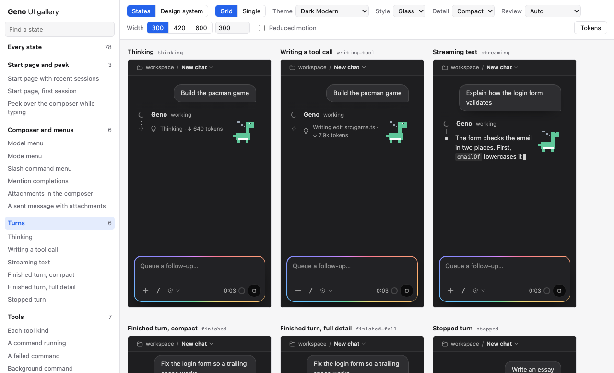
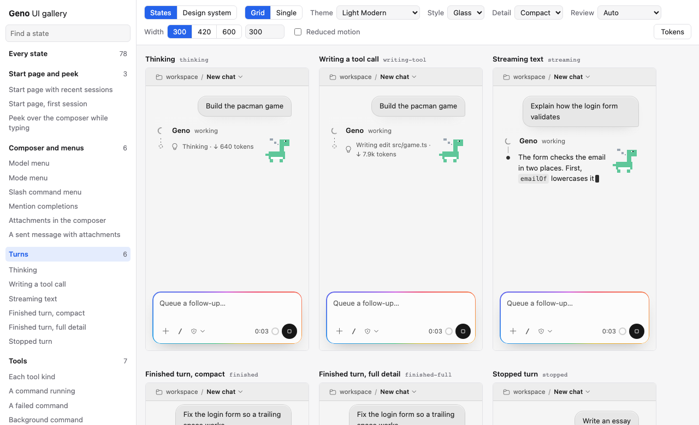
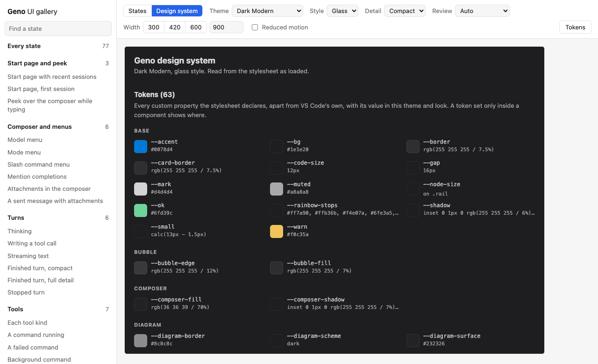
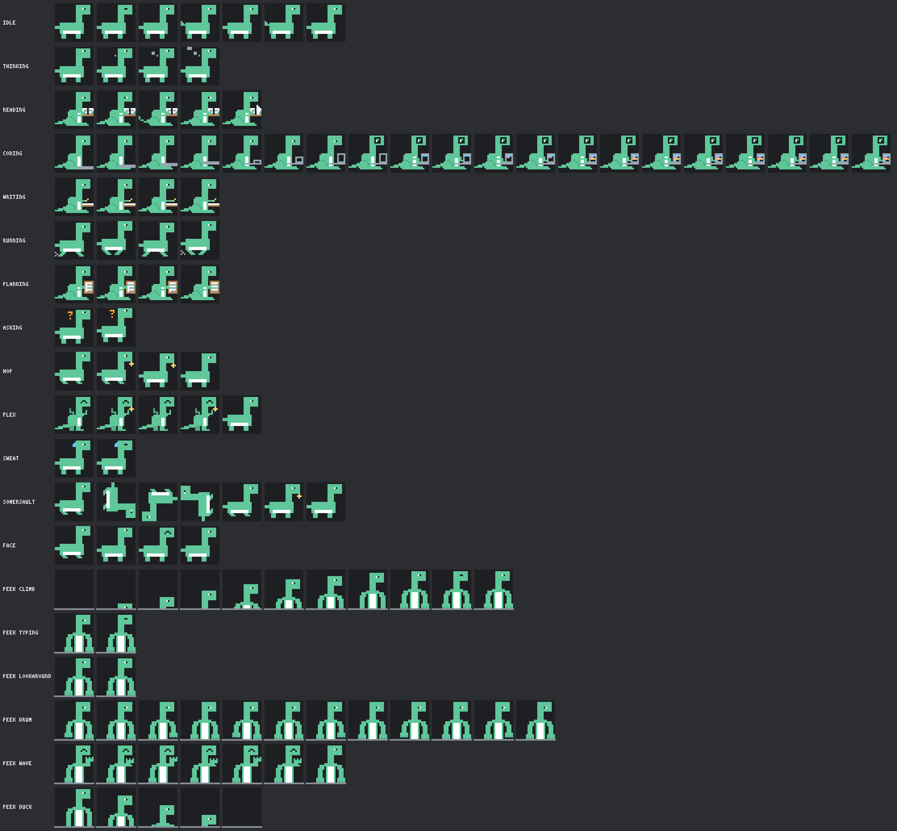
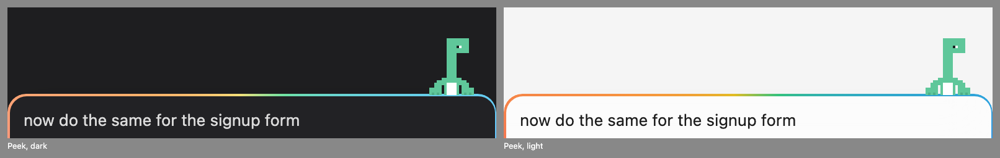
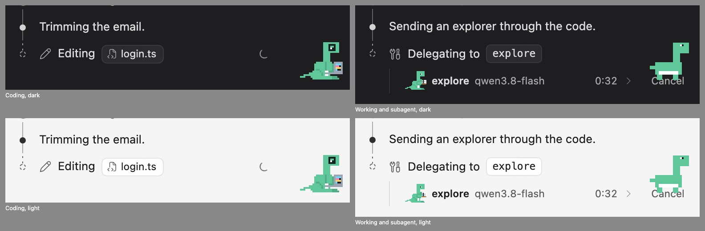
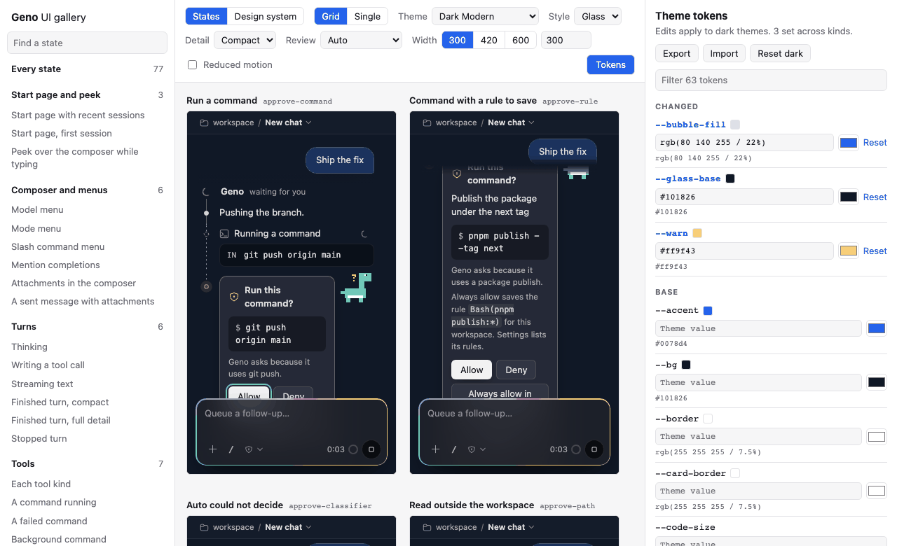

# UI gallery and themes

The UI gallery shows every state of the chat panel on one page, under each VS Code theme, so you can change the panel's look and see every state change with it. Each state runs the real panel bundles, built from source, against a fake extension host. The same states run in a webview test, so a state you add to the gallery is also checked in all four themes.



## Run the gallery

1. Start the server from the repository root:

	```sh
	pnpm ui
	```

	It prints `Geno UI gallery: http://127.0.0.1:5390/`. Set `GCODE_UI_PORT` to use another port. The server listens on 127.0.0.1 only.

2. Open the URL in a browser.

The server builds the panel's browser bundles from `BUNDLES` in `packages/extension/build.mts` and watches the sources. After you save a file in `src/chat` or `test/gallery`, it rebuilds and the page reloads with your controls kept. A failed build shows its error in a red bar above the frames.

To stop the server, press Ctrl+C.

## Find your way around the page

- **The sidebar** lists every state by group. Click a group name to see its states in a grid. Click a state to see it alone. **Every state** shows all of them.
- **States and Design system** switch between the panel states and the design-system page.
- **Grid and Single** pick many frames at once or one tall frame.
- **Theme** picks one of the four themes captured from a real VS Code window: Dark Modern, Light Modern, Dark High Contrast, and Light High Contrast. The dumps are in `packages/extension/test/webview/themes`.
- **Style**, **Detail**, and **Review** set the look as `gcode.ui.style`, `gcode.chat.detail`, and `gcode.review.mode` do. A state that needs a detail, such as full detail for a diff, keeps it.
- **Width** sets the panel width to 300, 420, or 600 pixels, or to the number you type.
- **Reduced motion** makes the panel's stylesheet and its `matchMedia` checks answer as if the system asked for reduced motion.
- **Tokens** opens the token panel.

A red badge on a frame counts its problems: errors the page logged, CSP refusals, and elements that run past the panel edge. Hover the badge to read them.



The design-system page reads the panel's stylesheet as the page loaded it. It shows every Geno token with its value, the type scale, the spacing, the radii, every codicon that `src/chat` draws, and each Noodle pose and peek move. Nothing on it is copied by hand, so it stays true when the CSS changes.



Noodle, the dinosaur, walks, runs and thinks on four legs. To hold or work something, it sits back on its haunches with both hind feet on the ground and uses its thick front legs, as a circus elephant does: it holds up a notebook or clipboard, types on a laptop and writes on a pad. It rears up on its hind legs to flex. Over the composer it rests its two front feet on the edge and looks over. Every pose and peek move, frame by frame, at 4×:







## Add a state

Every state is one entry in `FIXTURES` in `packages/extension/test/gallery/fixtures.ts`:

```ts
{
	id: 'tool-failed',
	group: 'Tools',
	title: 'A failed command',
	look: { detail: 'full' },
	play: async ({ host }) => {
		await host.act(turnStart('t0', 'Run the tests'), toolStart('tu_t', { name: 'bash', input: { command: 'pnpm test' } }));
		await host.act(toolEnd('tu_t', 'failed', 'FAIL src/login.test.ts'), ended());
	},
},
```

`play` gets a `Stage`. `stage.host` is the `FakeHost` from `test/webview/host.ts`. Call `host.act` with the actions the extension dispatches, and `host.post` with any other message the extension sends, such as `show-settings` or `mcp`. The helpers in `test/webview/turns.ts` build the common actions. To answer a message the panel sends, register a handler with `host.on`, as the `history` state does for `list-sessions`. To act as the user, use `stage.click`, `stage.fill`, and `stage.reveal`. To wait for the panel, use `stage.shows`.

The state then appears in the gallery and in `packages/extension/test/webview/gallery.webview.test.ts`. That test opens each state at 300 pixels in each of the four themes, and at 240 pixels in Dark Modern. It fails when the page logs an error or when anything runs past the panel edge. To run it alone:

```sh
pnpm vitest run --project webview packages/extension/test/webview/gallery.webview.test.ts
```

A state that shows images, such as the **Shown files** group, gives the panel the root `/gallery-media` and names its files under it. `test/gallery/media.ts` paints those PNGs, and the gallery server and the webview test serve them, so no image file sits in the repository. To add an image, add a painter to `MEDIA` there. `show-files.webview.test.ts` opens each Shown files state at 240 and 300 pixels in each theme.

## Real sessions

The **Real sessions** group plays sessions from the real-model campaign (`docs/results/real-usecases/runs/`) as the panel showed them:

| State | Run | What it shows |
| --- | --- | --- |
| `real-code-fix` | A13 run 1 | A finished code fix with its diff, in full detail. |
| `real-plan-todo` | A10 run 1 | A Plan run that ends with a todo list and a plan. |
| `real-subagent` | B07 run 2 | An explore subagent's row under its `agent` call, and the parent's own check. |
| `real-approval` | B01 run 1 | The card Ask showed for `rm -rf build`, with the turn still running. |
| `real-thai` | A02 run 1 | A Thai prompt, the Thai answer and the edit. |

No action in them is written by hand. `scripts/run-to-gallery.ts` reads each run's `session.jsonl`, replays it with the engine's own `replayUpdates` (what a session load sends), and turns each update into the panel's actions with the extension's own mapping in `src/chat/session-updates.ts`, which `ChatProvider` uses for the same updates. A subagent's start and end are its `child-start` and `child-end` events as the engine's subagent notice carries them, with the child's own log replayed under it. The approval card is the request the engine's `approve` would send for the command today, from `ruledDenial` and `optionsFor`, and the script fails if today's rule differs from the one the run logged. Paths into the run's workspace are written relative to it, and the gallery moves the times so each session ends when the state plays.

The script writes `packages/extension/test/gallery/real-sessions.ts`. `scripts/run-to-gallery.test.ts` fails when the file differs from what the script makes today, so a change to the replay or the mapping shows up as a diff to review. To add a state, add the run to `STATES` in the script, then:

```sh
pnpm tsx scripts/run-to-gallery.ts
pnpm vitest run --project webview packages/extension/test/webview/gallery.webview.test.ts -t real-
```

## Make a theme

1. Click **Tokens**. The token panel lists every Geno custom property, grouped by prefix. Each row shows the value the panel computes in the current theme.
2. Pick the theme you want to change. Your edits apply to that kind of theme: dark, light, high contrast, or high contrast light.
3. Type a CSS value, or pick a color. Every frame updates at once. A row you changed shows its name in blue, with **Reset** beside it.
4. To make the theme for another kind, switch the theme and edit again.
5. Click **Export**. The gallery saves `geno-theme.json`.



To start from a theme someone shared, click **Import** and choose its file. The gallery drops what the extension would drop and lists why.

The gallery keeps your edits in the browser's storage. They survive a reload of the page, not a change of browser.

## Share and use a theme

`geno-theme.json` holds the value of the `gcode.appearance.tokens` setting. To use it, paste it into your user `settings.json`:

```json
"gcode.appearance.tokens": {
	"dark": { "--glass-base": "#101826", "--warn": "#ff9f43" },
	"light": { "--glass-base": "#f4f1ea" }
}
```

The panel applies the setting when it loads and again when you change it, without a reload.

- The keys are theme kinds: `dark`, `light`, `highContrast`, and `highContrastLight`. A kind you leave out keeps Geno's own values. High contrast changes only when you name its kind.
- Each kind maps Geno token names, with their leading `--`, to CSS values. The extension checks each name against the tokens that `dist/webview.css` declares.
- The extension ignores an unknown kind, an unknown token, and VS Code's own `--vscode-*` variables. It also ignores a value that holds `;`, `{`, `}`, `<`, `>`, `\`, or `!`, a value that loads a resource such as `url(...)`, and a value with an open bracket or quote. Each one it ignores shows as a warning and as an `appearance:` line in the **Geno engine** output.
- The panel sets each value on every element and marks it important, so it wins over the style's and the components' own values. Tokens that Geno builds from it, such as `--surface` from `--bg`, follow it.

## Update the screenshots

The screenshots on this page come from a running gallery. With `pnpm ui` running, run:

```sh
pnpm exec tsx packages/extension/test/gallery/screenshots.mts http://127.0.0.1:5390/ docs/ui-gallery
```

Add `--groups` to also shoot every group in dark and light, which helps when you review a change across states.
