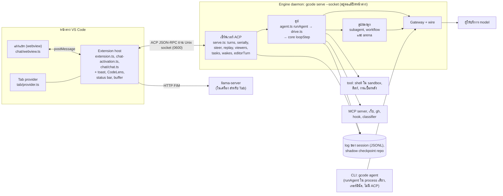

หน้านี้ตอบคำถามว่า Geno รันเป็นโปรแกรมกี่ตัว แต่ละตัวคุยกันด้วยอะไร และทำไมงานไม่หายเมื่อคุณ reload หน้าต่าง VS Code

คำตอบสั้นๆ คือ Geno ไม่ได้รันลูปของเอเจนต์ใน VS Code
ลูปที่เรียก model และรัน tool อยู่ใน **engine daemon** คือ process เบื้องหลังที่ไม่มีหน้าต่างของตัวเอง (`gcode serve --socket`)
หน้าต่าง VS Code แต่ละบานเป็นแค่ client ที่ต่อเข้ามา เหมือนแอปหน้าบ้านที่เรียก API server ตัวหนึ่ง
เมื่อหน้าต่างปิดหรือ reload ลูปใน engine ยังเดินต่อ แล้วหน้าต่างที่เปิดใหม่ก็ต่อกลับเข้าไปดูได้

ช่องทางในภาพมีสามแบบ ([ส่วนประกอบของ Geno](/foundations/parts-of-geno/) เล่าทีละจังหวะไว้แล้ว)

- **postMessage** ช่องส่งข้อความที่ VS Code ให้มาระหว่างแผงแชต (หน้าเว็บ) กับโค้ด extension
- **ACP ผ่าน Unix socket** ACP คือรูปแบบข้อความระหว่าง editor กับ agent เขียนเป็น JSON-RPC (request และ response เป็น JSON มี `method` กับ `id`)
  Unix socket คือไฟล์พิเศษในเครื่องที่สอง process ใช้ต่อหากันได้เหมือน TCP แต่ไม่ออกเครือข่าย `0600` แปลว่าเจ้าของเครื่องเท่านั้นที่เปิดได้
- **HTTP** จาก engine ไปหาผู้ให้บริการ model

## อ่านภาพนี้อย่างไร

- กล่องซ้ายคือสิ่งที่อยู่ในหน้าต่าง VS Code กล่องกลางคือ engine ส่วนรอบนอกคือสิ่งที่ engine ไปแตะ
- **ลูป** (`runAgent` → `drive` → `loopStep`) คือ agent loop ที่สอนไว้ใน [Agent loop](/foundations/agent-loop/)
- **ลูปของลูก** คือ loop ตัวเดียวกันที่รันให้ subagent (model อีกตัวที่ model หลักส่งงานไปให้ทำใน session ของมันเอง) รวมถึง workflow และ arena ซึ่งเป็นงานที่รันลูกหลายตัว
- **Gateway + wire** คือส่วนที่ประกอบ HTTP request ให้ตรงรูปแบบของผู้ให้บริการแต่ละเจ้า
- **log ของ session** คือไฟล์ JSONL ที่จดทุก event ของบทสนทนา **shadow checkpoint repo** คือ git repo ลับที่ Geno ใช้เก็บสำเนาไฟล์ก่อนแก้ เพื่อย้อนกลับได้

## สิ่งที่ควรรู้

- **Extension host** คือ process ของ VS Code ที่รันโค้ด extension มันเริ่มเมื่อ VS Code เปิดเสร็จ แล้ว `Engine` (`chat/engine.ts`) ต่อ socket ที่ `$TMPDIR/gcode-<hash>.sock`
  hash คิดจาก path ของ CLI โฟลเดอร์ และค่า environment ที่ส่งให้ engine ซึ่งรวม API key ด้วย ถ้าไม่มีใครตอบที่ socket นั้น `launch()` เปิด engine แบบ detached (ไม่ผูกกับหน้าต่าง) แล้วรอ socket นานสุด 20 วินาที
- **Engine daemon** หน้าต่างที่เปิดโฟลเดอร์เดียวกัน ตั้งค่าเดียวกัน และใช้ key เดียวกัน ได้ hash เดียวกัน จึงใช้ engine ตัวเดียวกัน
  engine อยู่ต่อเมื่อ reload หน้าต่าง และปิดตัวเอง 10 วินาทีหลังการเชื่อมต่อสุดท้ายปิด ถ้าไม่มีงานค้าง
  turn ที่เริ่มจากหน้าต่าง A จึงทำงานต่อและแสดงในหน้าต่าง B ได้
- **Viewers** คือตารางใน engine ที่จำว่าหน้าต่างไหนกำลังแสดง session ไหน ข้อความ update ของ session ที่ไม่มีหน้าต่างไหนแสดงจะถูกทิ้ง
  แต่ log ยังเก็บไว้ หน้าต่างที่เปิด session นั้นทีหลังจึงโหลดได้ครบ
  คำถามขออนุญาต (การ์ดที่ถามว่าให้รันคำสั่งนี้ไหม) ไม่ถูกทิ้ง มันรอจนมีหน้าต่างที่แสดง session นั้น
- **Webview** คือแผงแชต มันคุยกับ extension host เท่านั้น ไม่ได้ต่อ engine เอง host รับ `Action` (ข้อความบอกว่าแชตเปลี่ยนอย่างไร) มาปรับสำเนาแชตของตัวเอง แล้วส่ง `Action` เดียวกันให้ webview วาด
- **CLI** (`gcode agent`) รัน `runAgent` ใน process เดียว แสดงผลในเทอร์มินัล และถาม `[y/N]` แทนการ์ด ไม่มี ACP
- **Tab** คือการเติมโค้ดอัตโนมัติขณะคุณพิมพ์ มันไม่ผ่าน engine เลย มันส่งคำขอ FIM (fill-in-the-middle: ส่งโค้ดก่อนและหลังเคอร์เซอร์ ให้ model เติมตรงกลาง) ไปที่ `llama-server` ซึ่งเป็น model ตัวเล็กที่ extension เปิดไว้ในเครื่อง

ดูทุกส่วนเรียงตาม process และกระโดดเข้าทัวร์ได้ที่ [แผนที่ระบบ](/map/)
