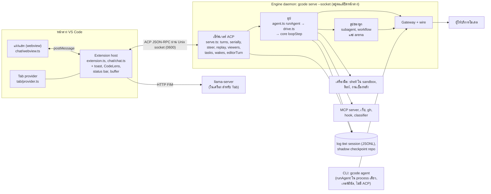

Geno ไม่ได้รันลูปของเอเจนต์ใน VS Code ลูปอยู่ใน engine daemon ที่แยกออกไป
หน้าต่าง VS Code แต่ละบานเป็นแค่ client ที่ต่อเข้ามา

## สิ่งที่ควรรู้

- **Extension host** เริ่มเมื่อ VS Code เปิดเสร็จ `Engine` (`chat/engine.ts`) ต่อ socket ที่ `$TMPDIR/gcode-<hash>.sock`
  hash คิดจาก path ของ CLI โฟลเดอร์ env ของ engine และ key ถ้าไม่มีใครตอบ `launch()` เปิด engine แบบ detached แล้วรอ socket นานสุด 20 วินาที
- **Engine daemon** หน้าต่างที่เปิดโฟลเดอร์เดียวกัน ตั้งค่าเดียวกัน และใช้ key เดียวกัน ใช้ engine ตัวเดียวกัน
  engine อยู่ต่อเมื่อ reload หน้าต่าง และปิดตัวเอง 10 วินาทีหลังการเชื่อมต่อสุดท้ายปิด ถ้าไม่มีงานค้าง
  turn ที่เริ่มจากหน้าต่าง A จึงทำงานต่อและแสดงในหน้าต่าง B ได้
- **Viewers** จำว่าการเชื่อมต่อไหนกำลังแสดง session ไหน อัปเดตของ session ที่ไม่มีหน้าต่างไหนแสดงจะถูกทิ้ง (log ยังเก็บไว้)
  คำขออนุญาตรอจนมีหน้าต่างที่แสดง session นั้น
- **Webview** คุยกับ extension host เท่านั้น host รับ `Action` ไปลดลงใน transcript ของตัวเอง แล้วส่ง `Action` เดียวกันให้ webview
- **CLI** (`gcode agent`) รัน `runAgent` ใน process เดียว แสดงผลในเทอร์มินัล และถาม `[y/N]` ไม่มี ACP
- **Tab** ไม่ผ่าน engine เลย มันส่งคำขอ FIM ไปที่ `llama-server` ที่ extension เปิดไว้ในเครื่อง

ดูทุกส่วนเรียงตาม process และกระโดดเข้าทัวร์ได้ที่ [แผนที่ระบบ](/map/)
