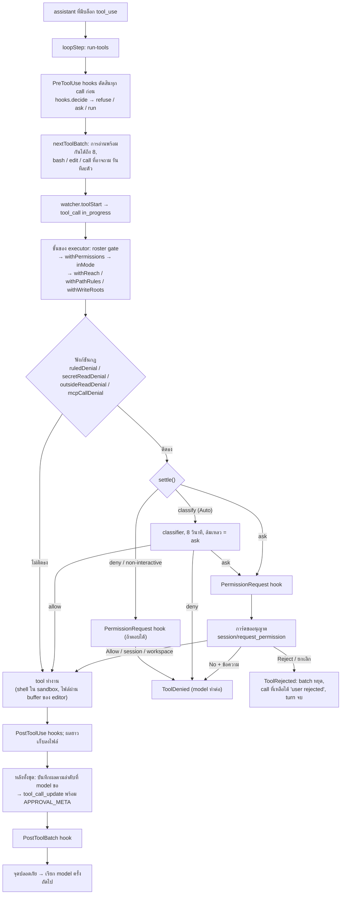

ทุก tool call เดินผ่านท่อเดียวกัน ทางแยกสำคัญคือ `settle()` ซึ่งเป็นฟังก์ชันเดียวที่ตัดสินทุกการกระทำที่ถูกตั้งธงไว้

## ปฏิเสธกับปฏิเสธพร้อมข้อความต่างกันอย่างไร

`ToolRejected` (ผู้ใช้กด Reject เฉยๆ) จบ turn ทันที ส่วน `ToolDenied` (กฎ, Auto, hook หรือผู้ใช้ปฏิเสธพร้อมข้อความ)
เป็นผลธรรมดาที่ model อ่านแล้วหาทางอื่นต่อ

## โหมดสิทธิ์

| โหมด | คำสั่งนอก safe list | การแก้ไฟล์ |
| --- | --- | --- |
| Plan | ปฏิเสธ | ปฏิเสธ (แสดงเป็นล้มเหลว) |
| Ask (ค่าเริ่มต้น) | แสดงการ์ดถามผู้ใช้ | ไม่ถาม ผู้ใช้ตรวจทีหลัง |
| Auto | ให้ classifier ตัดสิน ถ้าไม่แน่ใจก็ถามคุณ | ไม่ถาม |
| non-interactive | รันใน sandbox เพราะไม่มีใครให้ถาม | ไม่ถาม |

คำสั่งอันตราย เช่น `rm -rf` ของ workspace หรือ `.git` ยังถามเสมอแม้ใน Auto และกฎ allow ครอบคลุมไม่ได้
การอนุญาตไม่ได้ยกเว้น sandbox: shell ยังเขียนได้แค่ใน workspace และ temp และออกเน็ตได้เฉพาะโดเมนที่อนุญาต
ทางเดียวที่คำสั่งออกนอก sandbox คือ model ขอด้วย `dangerouslyDisableSandbox: true` แล้วคุณกดอนุญาตการ์ดของคำสั่งนั้น
การ์ดนี้ขึ้นทุกครั้งแม้ใน Auto ไม่มี classifier, hook หรือกฎ allow ตอบแทนคุณ และ Plan กับ run ที่ไม่มีใครให้ถามปฏิเสธเสมอ

เดินดูการ์ดและทางแยกทั้งสี่ได้ใน [โหมด Ask ขออนุญาตก่อนรันคำสั่ง](/scenarios/perm/ask-mode-bash-approval/)
