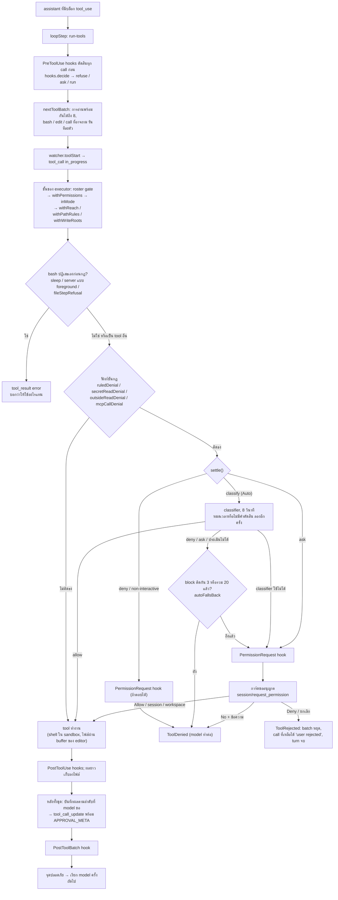

เมื่อ model ตอบกลับมาพร้อมบล็อก `tool_use` (คำขอให้รัน tool ดู [Tool คือสัญญา](/foundations/tools-are-contracts/)) Geno ไม่ได้รันทันที
ทุก tool call เดินผ่านท่อเดียวกัน ท่อนี้ตัดสินว่า call นั้นรันได้เลย ต้องถามคุณ หรือต้องปฏิเสธ แล้วส่งผลกลับไปเป็น `tool_result` ใน request ถัดไป
หน้านี้สำคัญเพราะการตัดสินเรื่องความปลอดภัยทั้งหมดของ Geno เกิดในท่อนี้ ไม่ใช่ใน model

## ท่อทีละขั้น

1. **Hook ก่อนรัน** hook คือคำสั่งที่คุณตั้งไว้ใน settings ให้ Geno รันเมื่อถึงจุดหนึ่งของ turn
   `PreToolUse` hook เห็นทุก call ก่อน และตอบได้ว่าปฏิเสธ ถามคุณ หรือรันเลย
2. **จัดชุด** call ที่อ่านอย่างเดียวรันพร้อมกันได้ครั้งละ 8 ตัว ส่วน `bash` `edit` และ call ที่อาจต้องถามคุณ รันทีละตัว
3. **ฟังก์ชันกฎ** ก่อนถึงกฎ `bash` ปฏิเสธบางบรรทัดเองโดยไม่ถามใครและไม่รันอะไรเลย ได้แก่ `sleep` ตั้งแต่ 2 วินาทีขึ้นไปที่ขึ้นต้นบรรทัดแล้วมีคำสั่งอื่นตามหลัง (`sleep 5` เดี่ยวๆ ยังรันได้)
   การเปิด server ทั้งแบบ foreground และแบบต่อท้ายด้วย `&` (สองข้อนี้เฉพาะ session ที่มี `run_in_background` ซึ่งเป็นตัวเลือกให้รันคำสั่งเบื้องหลัง ให้ใช้แทน)
   และขั้นที่เป็นงานของ tool ไฟล์ เช่น `cat` `head` `tail` ที่อ่านไฟล์ (งานของ `read`) หรือการเขียนข้อความตายตัวลงไฟล์ (งานของ `edit`)
   ผลเป็น `tool_result` ที่บอก model ว่าให้ใช้อะไรแทน
   บรรทัดที่ผ่านมาได้ ฟังก์ชันกฎดูว่าต้อง "ติดธง" ไหม เช่นคำสั่งไม่อยู่ใน safe list (รายการโปรแกรมที่อ่านอย่างเดียว เช่น `ls` `wc` `git status`)
   มีคำว่า `.env` อ่านไฟล์นอก workspace หรือเรียก tool ของ MCP server (โปรแกรมภายนอกที่ให้ tool เพิ่ม)
   ถ้าไม่ติดธง tool รันเลย
4. **`settle()`** คือฟังก์ชันเดียวที่ตัดสิน call ที่ติดธง คำตัดสินขึ้นกับโหมด (ตารางข้างล่าง):
   ปฏิเสธเลย ส่งให้ classifier หรือขึ้นการ์ดถามคุณ
   classifier คือ model call แยกอีกก้อนที่อ่านคำขอของคุณกับคำสั่ง แล้วตอบ allow, deny หรือ ask
   ถ้ามันไม่ตอบใน 8 วินาที หรือตอบมาโดยไม่มีคำตัดสิน Geno ลองอีกหนึ่งครั้ง ถ้ายังไม่ได้นับเป็น ask
   ส่วน error อื่น (เช่น API key ผิดหรือ server ล่ม) นับเป็น ask ทันทีโดยไม่ลองซ้ำ
   ก่อนขึ้นการ์ด `PermissionRequest` hook มีโอกาสตอบแทนคุณ ถ้า hook ไม่ตอบ การ์ดจึงขึ้น
5. **รัน** shell รันใน sandbox (ขอบเขตที่ระบบปฏิบัติการบังคับ: เขียนได้แค่ใน workspace และ temp ออกเน็ตได้แค่โดเมนที่อนุญาต) ไฟล์เขียนผ่าน buffer ของ editor
6. **หลังรัน** `PostToolUse` hook เห็นผล ผลที่ยาวมากถูกเก็บลงไฟล์ model ได้แค่ส่วนต้น ส่วนท้าย และ path ของไฟล์
   เมื่อทั้งชุดเสร็จ Geno บันทึกผลลง log ตามลำดับที่ model ขอ ส่งสถานะให้แผงแชต แล้วถึงจุดปลอดภัยก่อนเรียก model ครั้งถัดไป
   (จุดปลอดภัยคือช่วงที่ข้อความที่คุณพิมพ์แทรกระหว่าง turn ได้เข้าไปใน request)

ภาพข้างล่างคือท่อเดียวกันในชื่อฟังก์ชันจริง

## ปฏิเสธกับปฏิเสธพร้อมข้อความต่างกันอย่างไร

การปฏิเสธมีสองแบบ และให้ผลกับ turn ต่างกัน

- `ToolRejected` เกิดเมื่อคุณปฏิเสธเฉยๆ (กด Deny บนการ์ด หรือตอบ N ในเทอร์มินัล) turn จบทันที call ที่เหลือในชุดได้ผลว่า "user rejected"
  และ model ไม่ได้ถูกเรียกอีกจนกว่าคุณจะพิมพ์ข้อความถัดไป เหตุผลคือคุณเป็นคนที่ควรพูดต่อ
- `ToolDenied` เกิดเมื่อกฎ classifier หรือ hook ปฏิเสธ หรือเมื่อคุณปฏิเสธพร้อมพิมพ์ข้อความ
  มันเป็น `tool_result` ธรรมดาที่บอกเหตุผล model อ่านแล้วหาทางอื่นต่อใน turn เดิม

## โหมดสิทธิ์

คุณเลือกโหมดที่แผงแชตหรือด้วย `--mode` ใน CLI โหมดกำหนดว่า call ที่ติดธงจะไปทางไหน

| โหมด | คำสั่งนอก safe list | การแก้ไฟล์ |
| --- | --- | --- |
| Plan | ปฏิเสธ | ปฏิเสธ (แสดงเป็นล้มเหลว) |
| Ask (ค่าเริ่มต้น) | แสดงการ์ดถามผู้ใช้ | ไม่ถาม ผู้ใช้ตรวจทีหลัง |
| Auto | รันใน sandbox ไม่ถาม classifier ถ้าไม่มีกฎอื่นติดธง ถ้ากฎอื่นติดธง classifier ตัดสิน ถ้าไม่ผ่านก็ส่งเหตุผลกลับไปหา model | ไม่ถาม |
| non-interactive (`gcode agent --non-interactive` สำหรับ script ที่ไม่มีคนคอยตอบ) | รันใน sandbox เพราะไม่มีใครให้ถาม | ไม่ถาม |

ตารางนี้คือกฎของคำสั่งที่แค่ไม่อยู่ใน safe list (กฎ `unlisted`) เช่น `make build` หรือ `npm install` ข้อยกเว้นมีดังนี้

- **คำสั่งที่มีกฎเฉพาะไม่รันเองใน Auto** เช่น `curl` `git reset --hard` `rm -rf` ของโฟลเดอร์ย่อยใน workspace path นอก workspace
  การค้น credential ด้วย `grep -rn password .` (กฎ `secret-search`) `git push` ที่ force หรือไป branch deploy (กฎ `git-push-risky`) และ MCP tool
  กฎพวกนี้ถามคุณใน Ask ส่งให้ classifier ใน Auto และส่วนใหญ่ปฏิเสธใน run ที่ไม่มีใครให้ถาม
  ถ้าส่วนใดของ pipe หรือ list ติดธง classifier ตัดสินทั้งบรรทัด ส่วน `git push` ธรรมดาไปยัง branch ของ repo เองรันตามกฎใน Auto
- **ใน Auto คำว่าไม่ของ classifier ไม่ขึ้นการ์ด** classifier ตอบ `deny` หรือ `ask` หรือประเมินไม่ได้ (หมดเวลาหรือไม่มีคำตัดสินทั้งสองครั้ง หรือ request ล้มเหลว)
  call นั้นถูกปฏิเสธ เหตุผลกลับไปหา model เป็น `tool_result` ด้วยถ้อยคำแบบ dontAsk ของ Claude Code และ PermissionRequest hook ไม่ถูกถาม
  การปฏิเสธแบบนี้เรียกว่า block เมื่อ block ติดกันครบ 3 ครั้งหรือรวมครบ 20 ครั้งใน session (`autoBlocksOf` นับจาก log) block ถัดไปจึงขึ้นการ์ดให้คุณแทน
  call ไหนที่ได้รันก็ตัดแถว block ที่ติดกัน
- **classifier ที่ใช้ไม่ได้เลยขึ้นการ์ดทุก call** คือปิดอยู่ ไม่มี key หรือ provider ปฏิเสธ key หรือ model กรณีนี้ไม่นับเป็น block ถ้าไม่มี key หรือ key ถูกปฏิเสธ Geno บอกคุณครั้งเดียวต่อ session (ถ้าคุณปิดเองจะไม่มีข้อความ)
- **คำสั่งที่ย้อนไม่ได้ถามคุณเสมอแม้ใน Auto** เช่น `rm -rf` ของโฟลเดอร์ workspace ทั้งโฟลเดอร์ หรือของ `.git`
  กฎ allow ที่คุณบันทึกไว้ก็ครอบคลุมคำสั่งพวกนี้ไม่ได้
- **การอนุญาตไม่ได้ยกเว้น sandbox** คำสั่งที่คุณกด Allow แล้วก็ยังเขียนได้แค่ใน workspace และ temp และออกเน็ตได้เฉพาะโดเมนที่อนุญาต
- **ทางเดียวที่คำสั่งออกนอก sandbox** คือ model ขอด้วย `dangerouslyDisableSandbox: true` แล้วได้รับอนุญาต
  ใน Ask การ์ดขึ้นทุกครั้ง ใน Auto classifier ตัดสินก่อน แต่ถ้าคำสั่งแตะที่เก็บ credential ของเครื่อง (เช่น `~/.ssh` `~/.aws`) หรือเป็น `rm -rf` นอก workspace การ์ดก็ยังขึ้น
  hook และกฎ allow ตอบแทนคุณไม่ได้ ส่วน Plan กับ run ที่ไม่มีใครให้ถามปฏิเสธเสมอ

เดินดูการ์ดและทางแยกทั้งสี่ได้ใน [โหมด Ask ขออนุญาตก่อนรันคำสั่ง](/scenarios/perm/ask-mode-bash-approval/)
