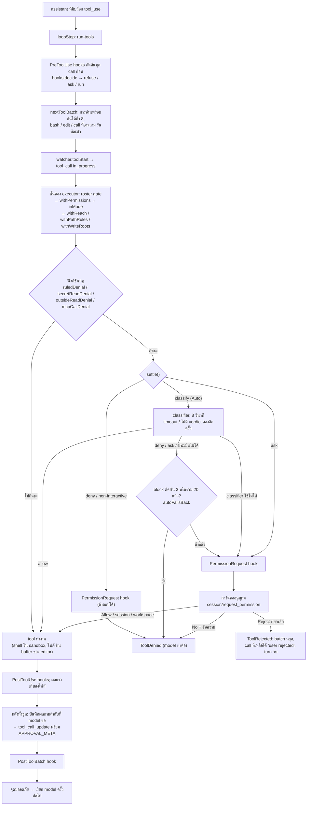

ทุก tool call เดินผ่านท่อเดียวกัน ทางแยกสำคัญคือ `settle()` ซึ่งเป็นฟังก์ชันเดียวที่ตัดสินทุกการกระทำที่ถูกตั้งธงไว้

## ปฏิเสธกับปฏิเสธพร้อมข้อความต่างกันอย่างไร

`ToolRejected` (ผู้ใช้กด Reject เฉยๆ) จบ turn ทันที ส่วน `ToolDenied` (กฎ, Auto, hook หรือผู้ใช้ปฏิเสธพร้อมข้อความ)
เป็นผลธรรมดาที่ model อ่านแล้วหาทางอื่นต่อ

## โหมดสิทธิ์

| โหมด | คำสั่งนอก safe list | การแก้ไฟล์ |
| --- | --- | --- |
| Plan | ปฏิเสธ | ปฏิเสธ (แสดงเป็นล้มเหลว) |
| Ask (ค่าเริ่มต้น) | แสดงการ์ดถามผู้ใช้ | ไม่ถาม ผู้ใช้ตรวจทีหลัง |
| Auto | รันใน sandbox โดยไม่ถาม classifier ถ้าไม่มีกฎอื่นติดธง ที่กฎอื่นติดธงให้ classifier ตัดสิน ถ้าไม่ผ่านก็ส่งเหตุผลกลับไปหา model | ไม่ถาม |
| non-interactive | รันใน sandbox เพราะไม่มีใครให้ถาม | ไม่ถาม |

ใน Auto คำสั่งที่มีแค่กฎ `unlisted` ติดธง เช่น `make build` หรือ `npm install` รันใน sandbox ตามกฎเลย
เช่นเดียวกับ `git push` ธรรมดาไปยัง branch ของ repo เอง ส่วนกฎอื่น เช่น `curl`, `git reset --hard`, `rm -rf` ใน workspace,
path นอก workspace, การค้น credential ด้วย `grep -rn password .` (`secret-search`), push ที่ force หรือไป branch deploy (`git-push-risky`)
และ MCP tool ยังให้ classifier ตัดสิน ส่วนไหนของ pipe หรือ list ติดธง classifier ก็ตัดสินทั้งบรรทัด
classifier ตอบ `deny` หรือ `ask` หรือประเมินไม่ได้ (timeout หรือไม่มี verdict ทั้งสองครั้ง หรือ request ล้มเหลว)
call นั้นถูกปฏิเสธโดยไม่มีการ์ด เหตุผลกลับไปหา model ด้วยถ้อยคำแบบ dontAsk ของ Claude Code และ PermissionRequest hook ไม่ถูกถาม
เมื่อ block ติดกันครบ 3 ครั้งหรือรวมครบ 20 ครั้งใน session (`autoBlocksOf` นับจาก log) block ถัดไปจึงขึ้นการ์ดให้คุณแทน
call ที่ได้รัน call ไหนก็ตัดแถว block ที่ติดกัน ส่วน classifier ที่ใช้ไม่ได้เลย (ปิดอยู่ ไม่มี key หรือ provider ปฏิเสธ key หรือ model)
ขึ้นการ์ดทุก call ไม่นับเป็น block และบอกคุณครั้งเดียว

คำสั่งอันตราย เช่น `rm -rf` ของ workspace หรือ `.git` ยังถามเสมอแม้ใน Auto และกฎ allow ครอบคลุมไม่ได้
การอนุญาตไม่ได้ยกเว้น sandbox: shell ยังเขียนได้แค่ใน workspace และ temp และออกเน็ตได้เฉพาะโดเมนที่อนุญาต
ทางเดียวที่คำสั่งออกนอก sandbox คือ model ขอด้วย `dangerouslyDisableSandbox: true` แล้วได้รับอนุญาต
ใน Ask การ์ดขึ้นทุกครั้ง ใน Auto classifier ตัดสินก่อน แต่คำสั่งที่แตะที่เก็บ credential หรือ `rm -rf` นอก workspace ยังขึ้นการ์ด hook และกฎ allow ไม่ตอบแทนคุณ และ Plan กับ run ที่ไม่มีใครให้ถามปฏิเสธเสมอ

เดินดูการ์ดและทางแยกทั้งสี่ได้ใน [โหมด Ask ขออนุญาตก่อนรันคำสั่ง](/scenarios/perm/ask-mode-bash-approval/)
