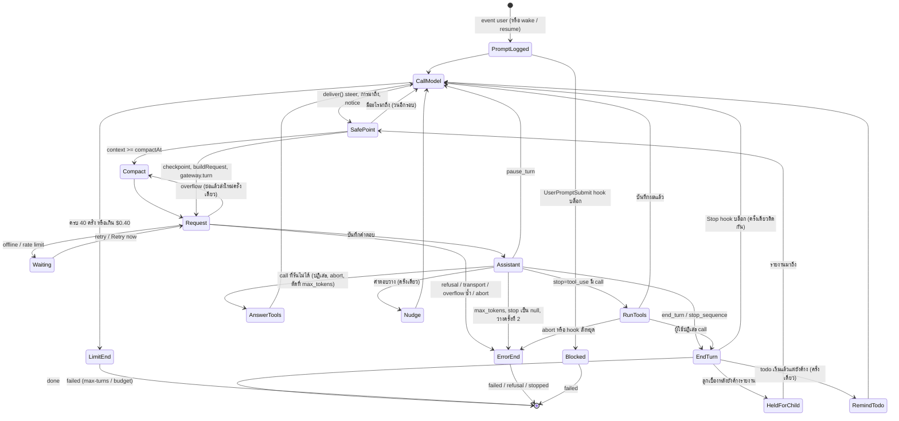

หน้านี้ตอบว่า ใน turn หนึ่ง (ตั้งแต่คุณส่ง prompt จนได้คำตอบสุดท้าย) Geno ตัดสินใจขั้นต่อไปอย่างไร และ turn จบได้กี่แบบ
ถ้าคุณเข้าใจหน้านี้ คุณจะบอกได้ว่าทำไม turn หนึ่งหยุด และหยุดเพราะใคร

หลักของมันมีข้อเดียว: **log ของ session คือความจริงเพียงแหล่งเดียว**
log คือไฟล์ที่ Geno จดทุกอย่างที่เกิดเป็น event ต่อท้ายกันไป เช่น prompt ของคุณ คำตอบของ model และผลของ tool
`drive` บันทึก prompt เป็น event `user` ก่อน ซึ่งทำให้ `UserPromptSubmit` hook (คำสั่งที่คุณตั้งไว้ให้รันทุกครั้งที่ส่ง prompt) อ่านได้และบล็อกได้
แล้ว `drive` วนถาม `loopStep` ว่าจะทำอะไรต่อ ทำตามนั้น จดผลลง log แล้วถามใหม่

`loopStep` เป็นฟังก์ชันบริสุทธิ์ของ log คือรับ log แล้วคืนขั้นถัดไป ไม่อ่านอะไรอื่น และไม่มีสถานะของ turn ที่อยู่แค่ในหน่วยความจำ
เหมือน REST server แบบ stateless ที่ตัดสินจาก request อย่างเดียว
ผลคือ ถ้า engine ล่มแล้วเริ่มใหม่ ถ้าคุณ reload หน้าต่าง หรือถ้า turn ถูกปลุกขึ้นมาใหม่ (เช่นงานเบื้องหลังเสร็จแล้วปลุก model ให้ทำต่อ)
Geno คำนวณขั้นต่อไปจาก log แบบเดียวกันหมด ไม่ต้องมีโค้ดกู้คืนแยก

## อ่านภาพนี้อย่างไร

แต่ละกล่องคือสถานะ ลูกศรคือเหตุที่ทำให้ย้ายไปสถานะถัดไป คำที่อาจไม่คุ้น:

- **SafePoint (จุดปลอดภัย)** ช่วงก่อนเรียก model ที่ Geno ส่งของที่มาถึงระหว่าง turn เข้า log: ข้อความที่คุณพิมพ์แทรก (steer) รายงานจากงานเบื้องหลัง และโน้ต `[Geno]`
- **Compact** ย่อบทสนทนาเมื่อ context (ขนาดของ request เทียบกับเพดานของ model) ถึงเกณฑ์ `compactAt` ของ model หรือค่าที่คุณตั้ง เกณฑ์ปกติคือ 80% ของเพดาน แต่ model เริ่มต้น qwen3.8-flash ตั้งไว้ที่ 200,000 token จากเพดาน 1,000,000 model ที่ Geno ไม่รู้จักไม่มีเกณฑ์นี้ จึงย่อเฉพาะตอนผู้ให้บริการตอบว่า request ยาวเกิน ดู [Memory และ context window](/foundations/memory-and-context/)
- **checkpoint** สำเนาไฟล์ที่ Geno เก็บไว้ก่อนเรียก model เพื่อย้อนการแก้ได้
- **Waiting** ออฟไลน์หรือโดน rate limit Geno รอแล้วลองใหม่ หรือคุณกด Retry now
- **stop_reason** field ในคำตอบของ model ที่บอกว่าทำไมหยุด (`end_turn` ตอบเสร็จ, `tool_use` ขอ tool, `max_tokens` คำตอบยาวเกินเพดาน, `pause_turn` ผู้ให้บริการขอให้ส่งต่อ) ดู [Model ตอบกลับอะไรได้บ้าง](/foundations/what-comes-back/)
- **AnswerTools** call ที่ห้ามรัน (อยู่หลัง call ที่คุณปฏิเสธ ถูกหยุดด้วยปุ่ม Stop หรือถูกตัดครึ่งเพราะ `max_tokens`) Geno ตอบผลแทนให้ครบทุก call ก่อนเรียก model ต่อ เพราะทุก `tool_use` ต้องมี `tool_result` คู่กัน
- **Nudge** model ตอบว่างเปล่า (มีแต่ความคิด) Geno เตือนหนึ่งครั้งให้ตอบ subagent ที่จบโดยยังไม่ส่งรายงานก็ได้เตือนหนึ่งครั้งเช่นกัน
- **RemindTodo** model จบ turn ทั้งที่รายการ todo เริ่มทำแล้วแต่ยังไม่ครบ Geno ส่งรายการกลับไปให้ model หนึ่งครั้งต่อ turn (ตั้งแต่ commit 7d5667c3)
- **HeldForChild** model บอกว่าจบ แต่ subagent ที่ทำงานเบื้องหลังยังไม่ส่งรายงาน turn จึงค้างไว้รอ
- **Stop hook** hook ที่รันตอน model จะจบ turn ถ้ามันบล็อก model ได้ทำต่ออีกรอบ แต่ไม่ติดกันสองครั้ง

## ลำดับการตัดสินใจใน `loopStep`

1. `lastLiveEvent` หยิบ event ของบทสนทนาล่าสุด ข้าม error ของรอบก่อนหน้าที่ยังเก็บ prompt ไว้ (เช่น `abort`) เพื่อให้ prompt ใหม่ทำต่อได้
2. event `error` นำไปสู่ `done`
3. `tool_use` ที่ยังไม่มีผลนำไปสู่ `answer-tools` ถ้า `unrunnable()` บอกว่ามี call ที่รันไม่ได้ ไม่เช่นนั้นเป็น `run-tools`
4. `tool-result` หลังผู้ใช้ปฏิเสธนำไปสู่ `done(end_turn)` ผู้ใช้คือคนที่พูดต่อ
5. ตาราง `AFTER_STOP`: `end_turn` และ `stop_sequence` จบ, `pause_turn` เรียก model ต่อ, `max_tokens` และ stop ที่เป็น null จบแบบ error, `refusal` จบแบบ refusal
6. คำตอบที่ว่าง (มีแต่ความคิด) ได้ `nudge` หนึ่งครั้ง ครั้งที่สองจบแบบ error
   คำตอบที่จบ (`end_turn`) ขณะรายการ todo เริ่มทำแล้วแต่ยังไม่ครบ ได้ `remind-todo` หนึ่งครั้ง Geno ส่งรายการนั้นกลับไปแล้วเรียก model อีกรอบ
7. ก่อน `call-model` ทุกครั้ง ตรวจขีดจำกัดของ turn: ค่าเริ่มต้นคือเรียก model ได้ 40 ครั้ง และใช้เงินได้ $0.40 ตามราคาของ qwen3.8-flash
   (ปรับตามราคาของ model ที่ใช้ เปลี่ยนได้ด้วย `--max-turns` และ `--max-cost`) เงินนับรวม compaction classifier และ call ที่ tool ทำเอง

## turn จบได้กี่แบบ

ลูปจบด้วยเหตุผลห้าแบบ (`end_turn`, `max-turns`, `budget`, `refusal`, `error`) หรือ `cancelled` เมื่อผู้ใช้กด Stop

engine บอกแผงแชตว่า turn จบอย่างไรผ่าน ACP (รูปแบบข้อความระหว่าง editor กับ engine ดู [ส่วนประกอบของ Geno](/foundations/parts-of-geno/))
คำตอบของ `session/prompt` มี `stopReason` แต่ ACP ไม่มีค่า "failed" เซิร์ฟเวอร์จึงแปลงด้วย `TURN_ENDS` เป็นค่าที่ใกล้ที่สุด
และส่งผลจริงไว้ใน `_meta` คอลัมน์ขวาสุดคือผลจริงนั้น: สำเร็จ (`done`) ล้มเหลว (`failed`) หรือถูกหยุด (`stopped`)

| ลูปจบด้วย | ACP `stopReason` | งานจบแบบ |
| --- | --- | --- |
| `end_turn` | `end_turn` | `done` |
| `max-turns`, `budget` | `max_turn_requests` | `failed` |
| `refusal` | `refusal` | `failed` |
| `error` | `end_turn` | `failed` |
| `cancelled` | `cancelled` | `stopped` |

เดินดูการตัดสินใจเหล่านี้ทีละขั้นได้ใน [model เรียก tool แล้วตอบ](/scenarios/turn/with-tools/)
