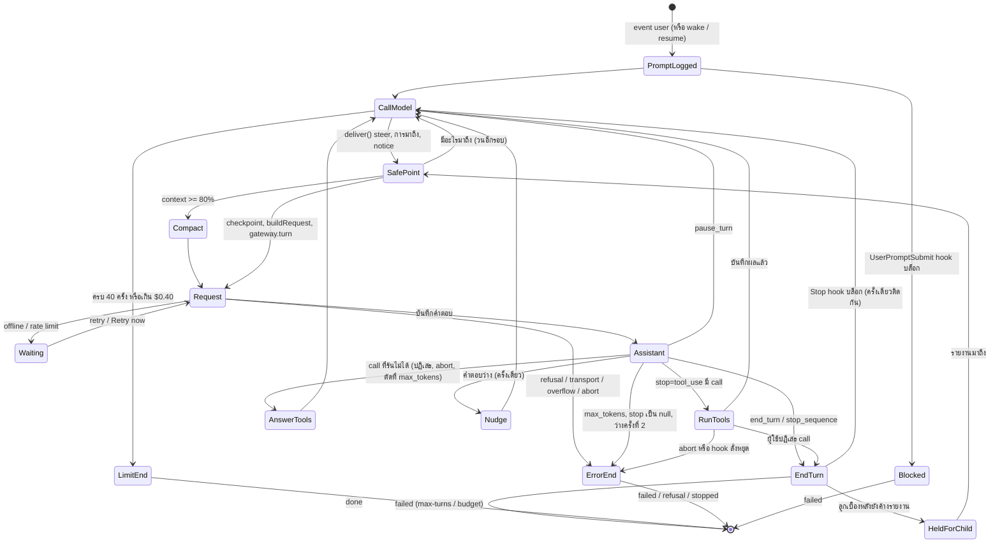

`drive` บันทึก prompt เป็น event `user` ให้ UserPromptSubmit hooks ได้อ่าน แล้ววนถาม `loopStep` ว่าจะทำอะไรต่อ
`loopStep` เป็นฟังก์ชันบริสุทธิ์ของ log: ไม่มีสถานะของ turn ที่อยู่แค่ในหน่วยความจำ
การกู้หลัง engine ล่ม การ reload prompt ใหม่ และ turn ที่ถูกปลุก จึงคำนวณขั้นต่อไปจาก log เหมือนกันหมด

## ลำดับการตัดสินใจใน `loopStep`

1. `lastLiveEvent` หยิบ event ของบทสนทนาล่าสุด ข้าม error ของรอบก่อนหน้าที่ยังเก็บ prompt ไว้ (เช่น `abort`) เพื่อให้ prompt ใหม่ทำต่อได้
2. event `error` นำไปสู่ `done`
3. `tool_use` ที่ยังไม่มีผลนำไปสู่ `answer-tools` ถ้า `unrunnable()` บอกว่ามี call ที่รันไม่ได้ ไม่เช่นนั้นเป็น `run-tools`
4. `tool-result` หลังผู้ใช้ปฏิเสธนำไปสู่ `done(end_turn)` ผู้ใช้คือคนที่พูดต่อ
5. ตาราง `AFTER_STOP`: `end_turn` และ `stop_sequence` จบ, `pause_turn` เรียก model ต่อ, `max_tokens` และ stop ที่เป็น null จบแบบ error, `refusal` จบแบบ refusal
6. คำตอบที่ว่าง (มีแต่ความคิด) ได้ `nudge` หนึ่งครั้ง ครั้งที่สองจบแบบ error
7. ก่อน `call-model` ทุกครั้ง ตรวจขีดจำกัดของรอบ: 40 ครั้งของการเรียก model และ $0.40 (นับรวม compaction และ classifier)

## turn จบได้กี่แบบ

ลูปจบด้วยเหตุผลห้าแบบ (`end_turn`, `max-turns`, `budget`, `refusal`, `error`) หรือ `cancelled` เมื่อผู้ใช้กด Stop
ACP บอก "failed" ไม่ได้ เซิร์ฟเวอร์จึงแปลงด้วย `TURN_ENDS` เป็น stop reason ของ ACP และส่งผลจริงใน `_meta`

| ลูปจบด้วย | ACP `stopReason` | งานจบแบบ |
| --- | --- | --- |
| `end_turn` | `end_turn` | `done` |
| `max-turns`, `budget` | `max_turn_requests` | `failed` |
| `refusal` | `refusal` | `failed` |
| `error` | `end_turn` | `failed` |
| `cancelled` | `cancelled` | `stopped` |

เดินดูการตัดสินใจเหล่านี้ทีละขั้นได้ใน [model เรียก tool แล้วตอบ](/scenarios/turn/with-tools/)
