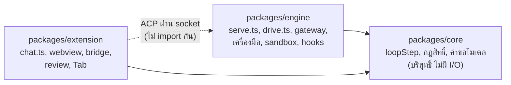

monorepo มีสามแพ็กเกจหลัก `packages/core` เป็นโค้ดบริสุทธิ์ที่ไม่แตะ I/O (ใช้ได้แค่ `node:path` และ `node:crypto`)
`packages/engine` คือ engine daemon และ CLI ส่วน `packages/extension` คือส่วนขยายของ VS Code และ webview

| เรื่อง | ไฟล์ |
| --- | --- |
| เปิดหน้าต่าง วงจรชีวิตของ engine | `packages/extension/src/extension.ts`, `chat/engine.ts`, `runtime.ts`; `packages/engine/src/daemon.ts`, `cli.ts`, `run.ts` |
| แผงแชท | `packages/extension/src/chat/webview.ts`, `render.ts`, `rail.ts`, `transcript.ts`, `messages.ts` |
| สะพาน host กับ engine | `packages/extension/src/chat/chat.ts`, `session-updates.ts`, `steer-host.ts`, `bridge.ts`, `tasks-host.ts` |
| เซิร์ฟเวอร์ ACP | `packages/engine/src/serve.ts` (`runTurn`, `editorTurn`, `TURN_ENDS`, `takeUpWaits`), `viewers.ts`, `session-replay.ts`, `tasks.ts` |
| ลูป | `packages/engine/src/agent.ts`, `drive.ts`; `packages/core/src/loop.ts`, `session.ts`, `request.ts`, `steer.ts` |
| การเรียกโมเดล | `packages/engine/src/gateway.ts`, `wire.ts`, `wire-openai.ts`, `stream-watch.ts`; `packages/core/src/model-error.ts` |
| Compaction | `packages/core/src/compaction.ts`; `packages/engine/src/compact.ts` |
| เครื่องมือ | `packages/engine/src/tools/*.ts`, `process.ts`, `files.ts`; `packages/core/src/tool-batch.ts`, `edit.ts` |
| นโยบาย | `packages/core/src/approval.ts`, `permission-rules.ts`, `auto.ts`, `classifier.ts`; `packages/engine/src/tools/agent.ts`, `permissions.ts` |
| Hooks | `packages/core/src/hooks.ts`; `packages/engine/src/hooks.ts`, `hook-config.ts` |
| Sandbox | `packages/engine/src/sandbox.ts`, `sandbox-host.ts` |
| Subagent และการปลุก | `packages/core/src/subagent.ts`, `wake.ts`; `packages/engine/src/subagents.ts`, `inbox.ts`, `wakes.ts`, `wake-hooks.ts` |
| Workflow, arena, lane | `packages/core/src/workflow.ts`, `arena.ts`, `lanes.ts`; `packages/engine/src/workflows.ts`, `arena.ts`, `lanes.ts` |
| Checkpoint และ rewind | `packages/engine/src/checkpoints.ts`, `rewind.ts`; `packages/extension/src/review/controller.ts` |
| ฟีเจอร์ของ editor | `packages/extension/src/tab/*` (Tab), `packages/engine/src/inline.ts` (Cmd-K) |
