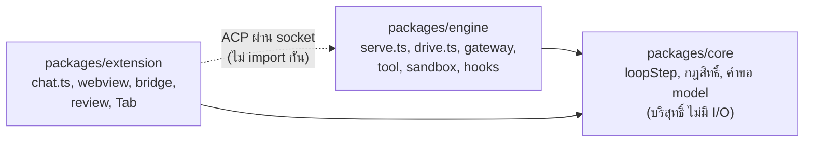

หน้านี้เป็นแผนที่สำหรับตอนที่คุณอยากเปิดโค้ดจริง เช่นเห็นชื่อฟังก์ชันในทัวร์แล้วอยากรู้ว่ามันอยู่แพ็กเกจไหน

monorepo มีสามแพ็กเกจหลัก (นอกจากนี้ `packages/docs` คือเว็บเอกสารนี้ และ `packages/web` เปิดแผงแชตเดียวกับของ extension ใน browser ธรรมดา)

- `packages/core` เป็นโค้ดบริสุทธิ์ที่ไม่แตะ I/O (ไม่อ่านไฟล์ ไม่ต่อเครือข่าย ใช้ได้แค่โมดูลของ Node ที่ไม่ทำ I/O อย่าง `node:path` `node:crypto` และ `node:url`)
  เช่น `loopStep` ที่ตัดสินขั้นถัดไปจาก log และกฎสิทธิ์ ข้อดีคือทดสอบได้ด้วยข้อมูลล้วนๆ และ engine กับ extension ใช้ร่วมกันได้
- `packages/engine` คือ engine daemon (process เบื้องหลังที่เดิน turn) และ CLI `gcode` ส่วนนี้คือส่วนที่อ่านไฟล์ รันคำสั่ง และเรียก model
- `packages/extension` คือส่วนขยายของ VS Code และ webview (หน้าเว็บของแผงแชต)

extension กับ engine ไม่ import โค้ดของกันและกัน มันคุยกันผ่าน ACP บน Unix socket เท่านั้น ดู [Process ของระบบ](/concepts/processes/)

ตารางนี้ใช้ชื่อฟีเจอร์ที่คุณจะเจอในส่วนสถานการณ์ ฟีเจอร์ที่อาจไม่คุ้น: **workflow** ไฟล์ JSON ที่สั่งให้ subagent ทำงานตามลำดับ เช่นรีวิว แก้ แล้วตรวจ
**lane** session ที่ทำงานใน git worktree และ branch ของตัวเอง **arena** รันงานเดียวกันหลาย lane พร้อมกันแล้วเลือกผลที่ดีที่สุด
**rewind** ย้อนไฟล์กลับไปที่ checkpoint **Tab** เติมโค้ดขณะพิมพ์ และ **Cmd-K** สั่งแก้โค้ดตรงที่เลือกใน editor

| เรื่อง | ไฟล์ |
| --- | --- |
| เปิดหน้าต่าง วงจรชีวิตของ engine | `packages/extension/src/extension.ts`, `chat-activation.ts`, `chat/engine.ts`, `runtime.ts`; `packages/engine/src/daemon.ts`, `cli.ts`, `run.ts` |
| แผงแชท | `packages/extension/src/chat/webview.ts`, `render.ts`, `rail.ts`, `transcript.ts`, `messages.ts` |
| สะพาน host กับ engine | `packages/extension/src/chat/chat.ts`, `session-updates.ts`, `steer-host.ts`, `bridge.ts`, `tasks-host.ts` |
| เซิร์ฟเวอร์ ACP | `packages/engine/src/serve.ts` (`runTurn`, `editorTurn`, `TURN_ENDS`, `takeUpWaits`), `viewers.ts`, `session-replay.ts`, `tasks.ts` |
| ลูป | `packages/engine/src/agent.ts`, `drive.ts`; `packages/core/src/loop.ts`, `session.ts`, `request.ts`, `steer.ts` |
| การเรียก model | `packages/engine/src/gateway.ts`, `wire.ts`, `wire-openai.ts`, `stream-watch.ts`; `packages/core/src/model-error.ts` |
| Compaction | `packages/core/src/compaction.ts`; `packages/engine/src/compact.ts` |
| tool | `packages/engine/src/tools/*.ts`; `packages/engine/src/process.ts`, `files.ts`; `packages/core/src/tool-batch.ts`, `edit.ts` |
| นโยบาย | `packages/core/src/approval.ts`, `permission-rules.ts`, `classifier.ts`; `packages/engine/src/permissions.ts`, `tools/agent.ts` |
| Hooks | `packages/core/src/hooks.ts`; `packages/engine/src/hooks.ts`, `hook-config.ts` |
| Sandbox | `packages/engine/src/sandbox.ts`, `sandbox-host.ts` |
| Subagent และการปลุก | `packages/core/src/subagent.ts`, `wake.ts`; `packages/engine/src/subagents.ts`, `inbox.ts`, `wakes.ts`, `wake-hooks.ts` |
| Workflow, arena, lane | `packages/core/src/workflow.ts`, `arena.ts`, `lanes.ts`; `packages/engine/src/workflows.ts`, `arena.ts`, `lanes.ts` |
| Checkpoint และ rewind | `packages/engine/src/checkpoints.ts`, `rewind.ts`; `packages/extension/src/review/controller.ts` |
| ฟีเจอร์ของ editor | `packages/extension/src/tab/*` (Tab), `packages/engine/src/inline.ts` (Cmd-K) |
