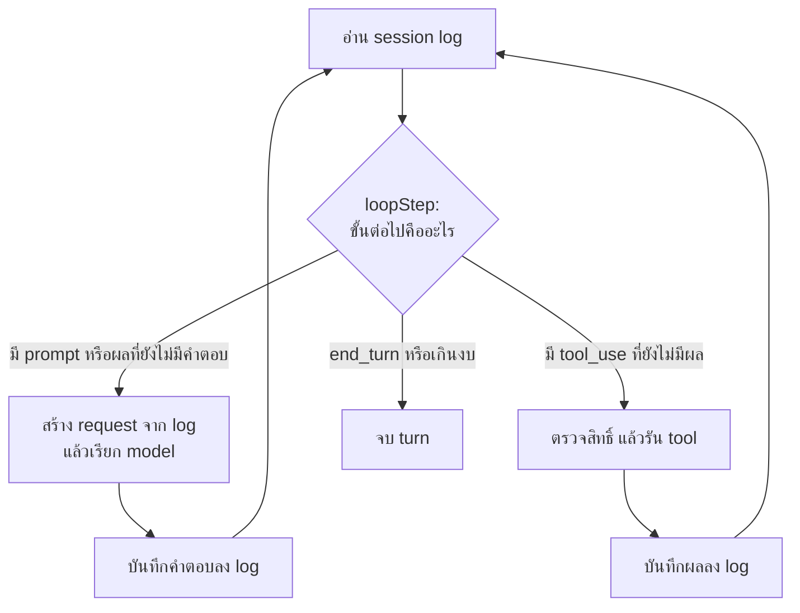

## loop ทั้งหมดมีแค่นี้

ทัวร์ข้างบนเรียก model สี่ครั้ง ทุกครั้งเป็นวงเดียวกัน

ใน Geno วงนี้คือ `drive` ใน `packages/engine/src/drive.ts` กับ `loopStep` ใน `packages/core/src/loop.ts`
`loopStep` เป็นฟังก์ชันบริสุทธิ์: รับ log คืนขั้นต่อไป ไม่มีสถานะซ่อนในหน่วยความจำ
ผลคือ loop ที่ถูกขัดจังหวะ (Stop, engine ล่ม, หน้าต่าง reload) เดินต่อได้จาก log เดิม

## สามเรื่องที่ทัวร์นี้แสดง

- **model เป็นคนตัดสินว่าผลแปลว่าอะไร** loop ส่ง "check `node --test` failed" กลับไปเฉยๆ
  model อ่านแล้วแยกเองว่าเทสต์ที่พังไม่ใช่ของงานนี้ และเลือกรันเฉพาะเทสต์ที่เกี่ยว
- **harness เป็นคนทำทุกอย่างที่แตะเครื่อง** อ่านไฟล์ แก้ไฟล์ รัน check ตรวจคำสั่ง และรันใน sandbox
- **request โตขึ้นทุกรอบ แต่จ่ายเพิ่มไม่มาก** cache อ่านได้ 5,594 แล้ว 8,826 แล้ว 9,282 แล้ว 11,085 token
  ส่วนที่เขียนลง cache ใหม่แต่ละรอบคือสิ่งที่เพิ่งต่อท้าย (`usage` ของ event `assistant` seq 4, 8, 11, 14 ใน `session.jsonl`)

การ์ด request ในทัวร์นี้สร้างใหม่จาก session log ตอนเก็บผล (`requests.jsonl`) ส่วนการ์ดคำตอบและผลของ tool คือ event ที่ Geno บันทึกจริง

## อะไรทำให้ loop หยุด

loop หยุดเมื่อ `loopStep` คืน `done` เหตุผลมีไม่กี่แบบ: model ตอบจบ (`end_turn`) ครบ 40 ครั้งหรือเกินงบ $0.40
คุณกด Stop คุณปฏิเสธการ์ด หรือ error ที่ retry ไม่ได้ ดูทุกแบบในบท [Model หยุดแบบไหนบ้าง](/scenarios/#ch-3)

## ต่อในบทนี้

- [จาก output สู่หน้าจอ](/foundations/output-to-screen/) ถ้า turn นี้รันในแผงแชต แต่ละจังหวะจะขึ้นจออย่างไร
- [Memory และ context window](/foundations/memory-and-context/) เมื่อ loop วนนานจนบทสนทนายาวเกิน
