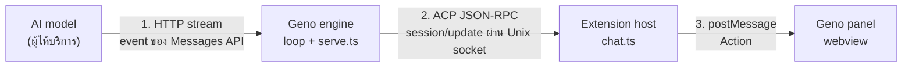

import Sees from '../../../components/Mock';

**ทุกอย่างที่คุณเห็นในแผงแชตเดินทางผ่านสามช่วง** และแต่ละช่วงเปลี่ยนรูปข้อมูลหนึ่งครั้ง
model ไม่รู้จักแผงแชต และแผงแชตไม่เคยคุยกับ model ตรงๆ

| ช่วง | ข้อมูลหน้าตาแบบไหน | โค้ด |
| --- | --- | --- |
| model ถึง engine | event ของ stream: `text_delta` `input_json_delta` `message_delta` | `drive.ts` เรียก watcher เช่น `text` และ `toolStart` |
| engine ถึง extension host | ACP `session/update` แบบ JSON-RPC หนึ่งบรรทัดต่อข้อความ | `editorTurn` ใน `packages/engine/src/serve.ts` |
| extension host ถึง webview | `Action` ของแผงแชต | `updateActions` ใน `packages/extension/src/chat/session-updates.ts` แล้ว `reduce` ใน `chat/transcript.ts` |

ACP (Agent Client Protocol) เป็นโปรโตคอลสาธารณะ engine เป็นฝั่ง agent และ extension เป็นฝั่ง client
Geno เพิ่ม method `_gcode/*` และ key `gcode/*` ใน `_meta` (field เสริมใน ACP ที่ client อื่นที่ไม่รู้จักข้ามไปได้) สำหรับสิ่งที่แผงของตัวเองวาดได้ editor อื่นที่พูด ACP ยังได้ข้อความที่อ่านรู้เรื่อง

extension host กับ webview ใช้ reducer ตัวเดียวกัน host เก็บ transcript ของตัวเองไว้ด้วย
เปิดแผงใหม่หรือ reload จึงวาดบทสนทนาเดิมได้ทันที

## ข้อความไหลเป็นตัวอักษรบนจอ

1. ผู้ให้บริการส่ง `text_delta` ทีละไม่กี่คำ `drive.ts` เรียก `watcher.text`
2. `editorTurn` ส่ง `session/update` ชนิด `agent_message_chunk` ที่มี text ชิ้นนั้น
3. extension host แปลงเป็น `Action` ชนิด `text` แล้วต่อท้ายบล็อกข้อความล่าสุด
4. webview เผยข้อความทีละ 1/6 ของส่วนที่ค้างต่อเฟรม อย่างน้อย 2 ตัวอักษร (`shownLength` ใน `chat/webview.ts`)
   ข้อความที่มาเป็นก้อนใหญ่จึงขึ้นนุ่มๆ แทนที่จะกระโดด
5. ทุกเฟรมแปลง Markdown เป็น DOM ใหม่ (`chat/markdown.ts`) HTML ที่ model เขียนแสดงเป็นตัวอักษร ไม่ถูกตีความ
   ลิงก์ทำงานเฉพาะ `http(s):` กับ `mailto:`

<Sees shown={[{ kind: 'message', from: 'geno', text: "I'll look at package.json, the src tree, and the test files.", streaming: true }]} />

**thinking ไม่ขึ้นจอ** engine ไม่ส่ง `agent_thought_chunk` เลย แผงแสดงแค่แถว "Thinking" ที่ข้อความมาจากสถานะของ stream:
`Thinking` `Writing the answer` หรือ `Writing <tool> <target>` (`packages/core/src/call-progress.ts`)

## tool call กลายเป็นขั้นในแชต

เมื่อ call เริ่ม engine ส่ง `tool_call` สถานะ `in_progress` พร้อมชื่อขั้น เช่น `read package.json`
เมื่อจบ ส่ง `tool_call_update` ที่มีสถานะและผล แผงจัดกลุ่มเป็นขั้น (`railOf` ใน `chat/rail.ts`):
`read` หรือ `edit` ที่ติดกันรวมเป็นแถวชิปไฟล์ `bash` ใช้ `description` ที่ model เขียนเป็นชื่อขั้น `todo` กลายเป็นรายการที่ปักไว้

<Sees shown={[{ kind: 'step', label: 'read package.json', status: 'running' }, { kind: 'step', label: 'read package.json', status: 'done', output: '"test": "node --test"' }]} />

## ทุกชนิดของ update และสิ่งที่คุณเห็น

| ACP update หรือ request | มาจากไหน | บนจอ |
| --- | --- | --- |
| `agent_message_chunk` | ข้อความของ model | ข้อความ Markdown พร้อมเคอร์เซอร์ |
| `agent_message_chunk` + `gcode/compact` | compaction เสร็จ | เส้นคั่นที่เปิดดูสรุปได้ |
| `agent_message_chunk` + `gcode/turnError` | turn ล้มเหลว | กล่อง error สีแดง หรือแถวเตือนสีส้มเมื่อชนขีดจำกัด |
| `tool_call` | call เริ่ม | ขั้นใหม่พร้อมจุดหมุน |
| `tool_call_update` | call จบหรือมีผล | สถานะ ผล รูปย่อ ป้าย "Denied by you" หรือ Auto |
| `tool_call_update` + `gcode/background` | คำสั่งเบื้องหลัง | แถวงานที่ยังรัน พร้อม tail และปุ่ม Stop |
| `notice` | retry, กำลัง compaction | แถวสถานะพร้อมจุดหมุน |
| `notice` + `gcode/progress` | สถานะของ stream | ป้ายบนแถว "Thinking" |
| `notice` + `gcode/waiting` | ออฟไลน์หรือโดน rate limit | หัวข้อ "waiting for the network" หรือ "waiting for the rate limit" และปุ่ม Retry now |
| `usage_update` | หลังทุกการเรียก model | วงแหวน context และค่าใช้จ่ายในช่องพิมพ์ |
| `session_info_update` | ตั้งชื่อแชต | ชื่อแชตด้านบน |
| `current_mode_update` | สลับโหมด | ปุ่มโหมด |
| `available_commands_update` | skill และคำสั่ง | เมนู `/` |
| `subagent_update` | subagent เริ่มหรือจบ | ขั้น subagent ที่ซ้อนอยู่ใต้ `agent` |
| request `session/request_permission` | ต้องขออนุญาต | การ์ด "Run this command?" หรือการ์ด memory |
| request `elicitation/create` | `ask_user` | การ์ดคำถามพร้อมตัวเลือก |
| request `fs/write_text_file` | `edit` | การ์ด diff สีแดงเขียว และปุ่ม Undo |
| คำตอบของ `session/prompt` | turn จบ | แถวท้าย: รุ่น model token เข้า ออก และค่าใช้จ่าย |

ตารางนี้สรุปจาก `UPDATES` ใน `session-updates.ts` และ `Chat.updated` ใน `chat/chat.ts`
การ์ดต่างจาก update ตรงที่เป็น **request** engine รอคำตอบของคุณก่อนเดินต่อ

<Sees shown={[{ kind: 'permission', command: 'rm -rf build', line: 'rm -rf build && ls -d build 2>&1; echo "exit: $?"', reason: 'Geno asks because it uses rm -rf of a path inside the workspace.', rule: 'rm -rf build' }]} />

## ข้อความ error ถึงจอได้สองแบบ

turn ที่ล้มเหลวส่ง `agent_message_chunk` ที่มีข้อความ `[<kind>] <message>` และ `_meta` `gcode/turnError`
แผงของ Geno เห็น `_meta` จึงวาดเป็นกล่อง error แต่ client ACP ทั่วไปที่ไม่รู้จัก `_meta` ก็ยังได้ข้อความอ่านรู้เรื่อง
`max-turns` และ `budget` เป็นแถวเตือน "Reached the turn limit" หรือ "Reached the cost limit" ส่วน `abort` (คุณกด Stop) ไม่มีกล่อง

## ท้าย turn

เมื่อ turn จบ คำขอ `session/prompt` ได้คำตอบที่มี `stopReason` และ `_meta` บอกผลจริง (`done` `stopped` `failed`) และ usage
แผงเปลี่ยนหัวข้อเป็น "worked for Ns" และวาดแถวท้าย turn (`turnFooter` ใน `chat/render.ts`)

## อ่านต่อ

- [รูปภาพและ multimodal](/foundations/images-and-multimodal/) รูปเดินทางผ่านสามช่วงนี้อย่างไร
- [ส่วนประกอบของ Geno](/foundations/parts-of-geno/) สาม process นี้หากันเจอได้อย่างไร
- ทัวร์ [กด Stop ขณะ model กำลังเขียน](/scenarios/ctl/stop-while-streaming/)
