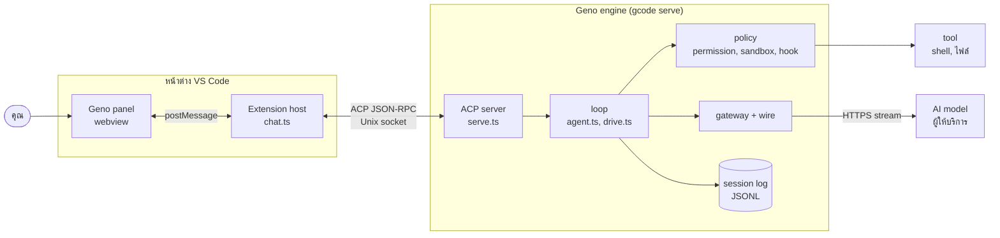

## เจ็ดส่วนและสามช่องทาง

ทัวร์ข้างบนเดินผ่านทุกส่วนของ Geno หนึ่งรอบ ตารางนี้สรุปว่าแต่ละส่วนคืออะไร
ตารางแยกละเอียดกว่าผู้เล่นห้าฝ่ายในทัวร์: **Geno panel** ในทัวร์คือ webview กับ extension host รวมกัน
**Geno engine** ในทัวร์คือ engine กับ policy รวมกัน และ **เครื่องของคุณ** คือแถว tool

| ส่วน | คืออะไร | อยู่ที่ไหน |
| --- | --- | --- |
| **คุณ** | คนพิมพ์ คลิก ตอบการ์ด และกด Stop | หน้าจอ |
| **Geno panel** (webview) | หน้าเว็บในแถบข้างของ VS Code วาดแชต การ์ด และช่องพิมพ์ ไม่มีสิทธิ์อ่านไฟล์หรือต่อเครือข่าย | `packages/extension/src/chat/webview.ts` |
| **VS Code extension host** | process ของ VS Code ที่รันโค้ด extension ของ Geno ถือการเชื่อมต่อกับ engine แปลง update เป็นสิ่งที่แผงวาด และเขียนไฟล์ผ่าน editor buffer | `packages/extension/src/chat/chat.ts` |
| **Geno engine** (server + loop) | process แยก (`gcode serve --socket`) ที่เดิน turn: ACP server ลูปของเอเจนต์ gateway ไปหา model และ log ของ session | `packages/engine/src/serve.ts` `agent.ts` `drive.ts` |
| **policy** | ส่วนของ engine ที่ตัดสินว่าแต่ละ tool call รันได้ไหม: กฎ permission โหมด classifier hook และ sandbox | `packages/engine/src/` และ `packages/core/src/` |
| **AI model** | API ของผู้ให้บริการ เช่น Model Studio Anthropic OpenRouter | นอกเครื่องของคุณ |
| **tool / เครื่องของคุณ** | shell ไฟล์ และโปรแกรมที่ tool แตะ คำสั่ง `bash` รันใน sandbox | เครื่องของคุณ |

คำในตาราง เช่น classifier hook และ sandbox มีคำอธิบายสั้นใน[คำศัพท์](/start/glossary/)

## สามช่องทาง

- **postMessage** ระหว่างแผงกับ extension host ช่องที่ VS Code เปิดให้หน้าเว็บในตัวมันส่ง JSON หาโค้ดของ extension และกลับ
- **ACP ผ่าน Unix socket** ระหว่าง extension host กับ engine
  ACP (Agent Client Protocol) เป็นโปรโตคอลสาธารณะสำหรับให้ editor คุยกับ agent ทุกข้อความเป็น JSON-RPC
  คือ JSON ที่มี `method` กับ `params` คำขอมี `id` และคำตอบอ้าง `id` เดิม
  ต่างจาก REST ตรงที่ทั้งสองฝั่งส่งคำขอหากันได้บนการเชื่อมต่อเดียว เช่น engine ขอให้แผงขึ้นการ์ดขออนุญาต
  และมี notification อย่าง `session/update` ที่ส่งไปเรื่อยๆ โดยไม่ต้องตอบ
- **HTTPS stream** ระหว่าง engine กับผู้ให้บริการ เป็น HTTP request ธรรมดาที่คำตอบทยอยมาเป็นชิ้น

## หากันเจอได้อย่างไร

ไม่มี registry หรือ port ที่ตั้งไว้ล่วงหน้า แต่ละส่วนหาคู่ของมันจากสิ่งที่มีอยู่แล้ว

- **แผงกับ extension host** VS Code ให้ช่อง postMessage มาเองตอนสร้าง webview
  แผงส่ง `ready` เมื่อโหลดเสร็จ แล้ว extension host ตอบด้วยบทสนทนาทั้งชุด
- **extension host กับ engine** ที่อยู่ของ socket คำนวณได้ ไม่ต้องจด: `socketPathOf` ใน `packages/extension/src/chat/engine.ts`
  hash path ของ CLI โฟลเดอร์ และค่า environment ของ engine เป็น `$TMPDIR/gcode-<hash>.sock`
  หน้าต่างที่เปิดโฟลเดอร์เดียวกันด้วยการตั้งค่าเดียวกันจึงได้ socket เดียวกัน และใช้ engine ตัวเดียวกัน
  ถ้าต่อไม่ได้ extension เปิด engine เองแบบ detached แล้วลองต่อใหม่ทุก 50 ms นานสุด 20 วินาที
- **engine รู้ว่า editor ทำอะไรได้** จาก `initialize` ที่ส่งความสามารถใน `_meta` (field เสริมที่ ACP เปิดไว้ให้ใส่ข้อมูลนอกมาตรฐาน) เช่น widget, Tasks และ editor action
  engine เก็บไว้เป็น `peer` และใช้ตัดสินว่าจะให้ model มี tool อย่าง `show_widget` หรือไม่
- **engine กับ model** ผู้ให้บริการและ model มาจากการตั้งค่าและ API key ที่ extension ส่งเป็น environment ของ engine
  `wireFor` ใน `packages/engine/src/wire.ts` เลือก wire ตามผู้ให้บริการ
  wire คือส่วนของ gateway ที่แปลง request เป็นรูปแบบที่ผู้ให้บริการรายนั้นรับ แล้วส่งออก (ดู[ผ่า request หนึ่งก้อน](/foundations/anatomy-of-a-request/))

engine อยู่ต่อเมื่อคุณ reload หน้าต่าง turn ที่กำลังทำงานจึงไม่หาย รายละเอียดอยู่ใน[Process ของระบบ](/concepts/processes/)
ถ้าคุณรัน `gcode agent` ในเทอร์มินัล loop ตัวเดียวกันรันใน process เดียว ไม่มีแผง ไม่มี ACP

## ต่อในบทนี้

- [ผ่า request หนึ่งก้อน](/foundations/anatomy-of-a-request/) request ที่ไปถึง model ในจังหวะสุดท้ายของทัวร์
- [จาก output สู่หน้าจอ](/foundations/output-to-screen/) ขากลับ จาก model ถึงแผงแชต
